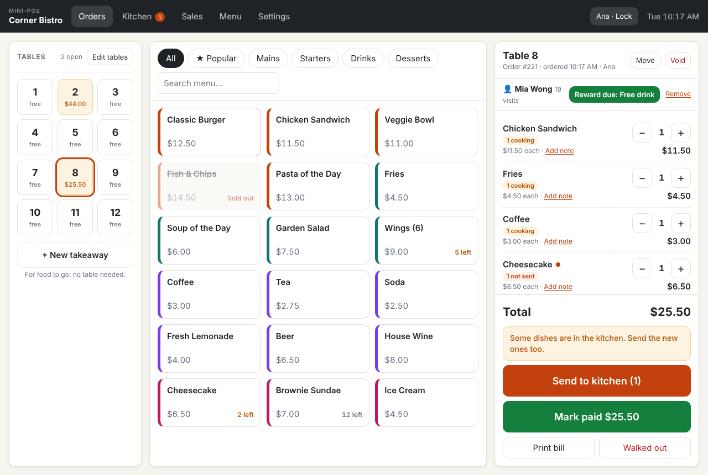
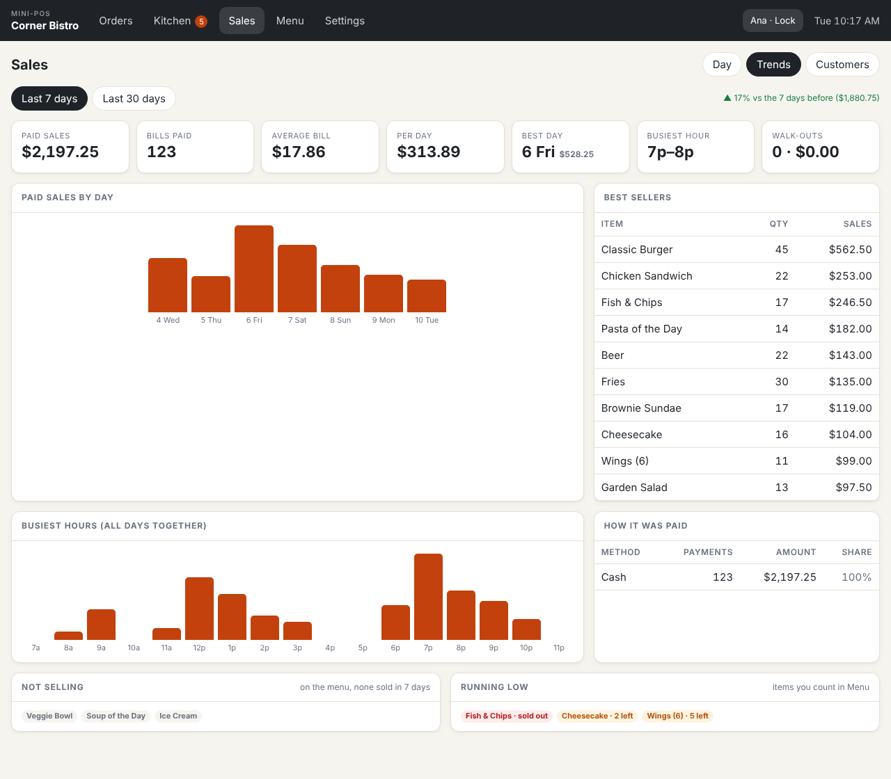

# Mini-POS

A lightweight point-of-sale for a small restaurant. Plain JavaScript (no framework), built with [Vite](https://vite.dev). It runs in the browser and works with no internet. Use it on one device with nothing else to install, or run the included **server** on one computer so several tablets and a kitchen screen share the same data over the restaurant's Wi-Fi, with a real database and server-checked sign-in. No internet is needed either way.

## Features

- **Tables & takeaway**: tap a table to start or reopen its order; open tables show their running total. **New takeaway** starts an order with no table (food to go); it appears under "Takeaway & other" once you add the first item. Move an order to another table or turn it into a takeaway.
- **Manage tables**: on the Orders screen tap **Edit tables**, then tap **+** to add a table, or tap a table to rename it (e.g. "Patio", "Bar 2") or remove it. Tables with an open order can't be removed. Finished orders keep their table name.
- **Fast ordering**: menu tiles grouped by colour-coded category, search, quantity +/−, per-item notes with quick presets ("No onions", "Extra spicy", …). A **★ Popular** tab lists your best sellers of the last 30 days, best first, so the usual orders are one tap away.
- **Stock and sold out**: in **Menu**, type how many portions of an item you have in the **Left** column (leave it blank for items you never run out of). The count goes down as the item is ordered, the tile shows "3 left" when it runs low, and at zero it reads **Sold out** and can't be ordered. A portion comes back only if it is removed before being sent to the kitchen. Menu and Sales → Trends list what is running low.
- **Per-dish kitchen orders**: "Send to kitchen" turns each line into its own dish order ("2× Burger" sent together is one dish), stamped with the time it was sent. The kitchen screen groups dishes by table, and each dish has its own timer (amber after 8 minutes, red after 15) and its own **Ready** button, which records that dish's completion time. Items added later are sent as new dishes with their own times.
- **Paying**: tap **Mark paid** when the customer pays, before or after eating, then confirm with **Paid**. Payment is cash only by default; if you take other kinds of payment, list them in Settings and each gets its own button. A bill completes, and its table frees, only when every dish is served **and** it is paid. Items added after paying show the balance still due. **Recall** puts a ready dish back in the kitchen and reopens its table if needed. Removing a dish that is still cooking takes it off the kitchen screen. Prices are final, with no tax, discount or tip.
- **Walk-out protection**: a table whose dishes are all served but unpaid turns **red** ("unpaid $17.00") and stays occupied, and its ticket warns to take payment before the customer leaves. Sales shows an **Awaiting payment** list. If a customer leaves without paying, **Walked out** records the loss and frees the table, so it shows in Sales instead of disappearing.
- **Unpaid alarm**: if a served table is still unpaid after a set time (5 minutes by default), its tile flashes, a red banner appears at the top of every screen (Orders, Kitchen, Sales…) with **Open** and **Customer still here** (snooze 10 minutes), and an alert sound plays, repeating every 3 minutes until it is paid. Set the minutes (0 = off) and the sound in **Settings**. The sound starts working after the first tap on the page, as browsers require.
- **Receipts**: **Print bill** (open table) or **Receipt** (Sales) shows the receipt on screen; **Print** sends it to the printer. Receipts show the customer and who served, when those are recorded. Laid out for 80 mm thermal printers, and works with any printer or "Save as PDF".
- **Order times**: every dish logs when it was ordered (sent) and when the kitchen completed it. Each order line on the ticket shows how many are not sent, cooking or ready.
- **Sales · Day**: money counts only **paid** bills. For any day you see paid sales, bills paid, average bill, awaiting payment, walk-outs, dishes completed, average dish time, sales by hour, top items, **how it was paid** (and who took the payments), the day's bills (paid / walked out / void, with reprint and void), and a **dish log** (ordered, completed and time taken for every dish, with its bill status). Export the dish log to CSV.
- **Cash drawer and day report**: on the Day tab, enter the opening float and, at closing, the cash you counted. The app shows what should be in the drawer (float + cash sales) and whether you are over or short. **Day report** prints the day's totals, payment split, drawer and items sold on the receipt printer.
- **Sales · Trends**: the last 7 or 30 days compared with the period before: sales by day, best day, busiest hours, best sellers, payment split, menu items that did not sell at all, and items running low.
- **Customers and rewards**: on a ticket tap **+ Add customer** to look up a regular by name or phone, or add a new one. Nothing is ever sent to them. Each paid bill counts as a visit; after a set number of visits (10 by default) the ticket shows **Reward due**, and tapping it adds the reward (e.g. "Free drink") as a free line that goes to the kitchen and prints on the receipt. **Sales → Customers** lists everyone with visits, money spent, last visit and reward progress.
- **Staff sign-in (optional)**: in **Settings → Staff & PINs** add yourself first (you become the manager), then your staff, each with a 4-digit PIN. From then on the app asks who is working, puts that name on orders, payments and receipts, and keeps these for managers: voiding orders and paid bills, recording walk-outs, removing dishes already sent to the kitchen, editing tables, and the Sales, Menu and Settings screens. A staff member can still do one of those if a manager types their PIN. Tap your name in the header to lock or switch user. An **activity log** in Settings records voids, walk-outs, removed dishes, rewards and staff changes, with who did it and who approved it.
- **Menu editor** and **settings** (name, location, phone, currency symbol, receipt footer, unpaid alarm minutes and sound, ways to pay, low-stock level, reward rule). The bottom of every receipt shows the restaurant name, location and phone.
- **Several devices, one database (optional)**: run the included server on one computer in the restaurant. Tablets and a kitchen screen open it over the local network and stay in step within a moment of each other; data is kept in a SQLite database on that computer. Each device connects once with the **owner password**, staff PINs are checked by the server, and manager-only actions are enforced there. A device that loses the server keeps working and sends its changes when it is back. See [Running the server](#running-the-server).
- **Data folder**: in **Settings → Data**, choose a folder on the computer and the app keeps a copy of everything there as CSV files, updated a moment after every change. The files survive clearing the browser's data, open in Excel, and can be copied to a USB stick. Needs Chrome or Edge on a computer (see [Where the data lives](#where-the-data-lives)).
- **Backups in CSV**: **Export backup (CSV)** downloads one ZIP with a CSV file per kind of record (menu, orders, order lines, dishes, payments, customers, staff, settings…). **Import backup** restores from that ZIP, or from the CSV files selected together, on this or another device. Settings shows when you last made one.
- **Works with no internet**: once the app has been opened online, it is saved on the device and opens without a connection. It can be installed to the home screen like an app.

## Screenshots

Taken with sample data ("Corner Bistro"). The image files are in [`docs/screenshots/`](docs/screenshots).

| Screen                                                          | What it shows                                                                                                        |
| --------------------------------------------------------------- | -------------------------------------------------------------------------------------------------------------------- |
| [Orders](docs/screenshots/orders.png)                           | Tables, menu tiles with stock ("2 left", "Sold out"), the Popular tab, and a ticket with a customer and a reward due |
| [Mark paid](docs/screenshots/mark-paid.png)                     | The payment confirmation                                                                                             |
| [Kitchen](docs/screenshots/kitchen.png)                         | Dishes cooking, grouped by table                                                                                     |
| [Sales · Day](docs/screenshots/sales-day.png)                   | The day's figures, bills awaiting payment and the cash drawer                                                        |
| [Day report](docs/screenshots/day-report.png)                   | The printable end-of-day report                                                                                      |
| [Sales · Trends](docs/screenshots/sales-trends.png)             | The last 7 days against the week before, best sellers, busiest hours                                                 |
| [Sales · Customers](docs/screenshots/customers.png)             | Regular customers with visits, spend and reward progress                                                             |
| [Menu](docs/screenshots/menu-stock.png)                         | The menu editor with the **Left** (stock) column                                                                     |
| [Settings · Staff & PINs](docs/screenshots/settings-staff.png)  | The staff list and the activity log                                                                                  |
| [Lock screen](docs/screenshots/lock-screen.png)                 | "Who is working?" when staff sign-in is on                                                                           |
| [Manager PIN](docs/screenshots/manager-pin.png)                 | A manager approving a staff member's void                                                                            |
| [Data folder and backup](docs/screenshots/data-folder.png)      | Settings → Data: saving to a folder on the computer, CSV backup                                                      |
| [Server: first run](docs/screenshots/server-setup.png)          | Choosing the owner password when the server is first started                                                         |
| [Server: connect a device](docs/screenshots/server-connect.png) | A tablet being asked for the owner password                                                                          |
| [Server: no connection](docs/screenshots/server-offline.png)    | The banner while the server can't be reached; orders are still taken                                                 |
| [Server panel](docs/screenshots/server-panel.png)               | Settings: staff PINs checked by the server, activity log, connection status                                          |





## Getting started

Requires Node.js 22.13 or newer (see `engines` in package.json).

```bash
npm install
npm run dev        # http://localhost:5173 with hot reload
```

| Script                 | What it does                       |
| ---------------------- | ---------------------------------- |
| `npm run dev`          | Start the dev server               |
| `npm run build`        | Production build into `dist/`      |
| `npm run preview`      | Serve the production build locally |
| `npm test`             | Run unit tests (Vitest)            |
| `npm run test:watch`   | Tests in watch mode                |
| `npm run lint`         | ESLint                             |
| `npm run format`       | Format everything with Prettier    |
| `npm run format:check` | Check formatting (useful in CI)    |

### First run

1. **Settings**: set your restaurant name, location, phone and currency.
   Then on **Orders**, tap **Edit tables** to add, rename or remove tables.
2. **Menu**: delete the sample items and add your own.
3. **Orders**: tap a table → tap items → **Send to kitchen**.
4. **Kitchen**: tap **Ready** on each dish as it's done.
5. **Pay**: tap **Mark paid** on the ticket (or in Sales → Awaiting payment), then **Paid**. The table frees once it is served and paid.
6. **Close the day**: in **Sales**, count the cash into the **Cash drawer** box and print the **Day report**.

## Running the server

For more than one device, or to keep the data in a database instead of a browser. Needs Node.js 22.13 or newer on one computer that stays on during service; nothing else to install and no internet.

```bash
npm install
npm start          # builds the app, then starts the server on port 8080
```

The server prints the addresses to open, for example `http://192.168.1.20:8080` for other devices on the same Wi-Fi. (`npm run server` starts it without rebuilding; `--port 9000` and `--data /path/to/folder` change the port and where data is kept.)

1. **First run**: open the app on the server computer and choose the **owner password** (at least 8 characters). If that browser already had Mini-POS data, it is copied to the server.
2. **Each other device**: open the address, enter the owner password and a name for the device ("Kitchen screen"). It then shows the server's data. This is needed once per device.
3. **Staff**: add them in **Settings → Staff & PINs**. A device with nobody signed in shows only the "Who is working?" screen.

### What the server keeps and protects

- **Database**: `data/mini-pos.db`, a single SQLite file. Each order, menu item, customer and so on is a row in `records`; the views `orders`, `order_lines`, `payments` and `menu_items` show them as ordinary columns in any SQLite tool. A copy of the database is written to `data/backups/` once a day and kept for two weeks. To move the restaurant to another computer, stop the server and copy the `data` folder.
- **Owner password**: stored only as a salted scrypt hash. A device without it gets no data at all. Five wrong tries lock that device's address out for a minute. Changing it (Settings → Server) disconnects every other device.
- **Staff PINs**: stored only on the server, as salted hashes, and never sent to a device. Five wrong tries lock the device for a minute. **Forgot the manager PIN?** needs the owner password.
- **Manager-only actions** (voids, walk-outs, removing dishes already sent, menu, tables, settings, cash drawer) are checked by the server for every change, so a tampered app on a staff device cannot do them. A manager's PIN approves one change.
- **The activity log** can be added to but not edited.
- **Two devices, same record**: if two devices change the same order at the same moment, the first to reach the server wins and the other is shown the server's version with a "Not saved" message. Different orders never clash. Two bills opened at the same moment get different numbers.

### HTTPS

By default the server uses plain HTTP, which is readable by anyone who can listen in on the Wi-Fi, so use a network with a password that customers don't have. To encrypt it, put `cert.pem` and `key.pem` in the `data` folder and restart; the server then uses HTTPS. A self-signed pair can be made with:

```bash
openssl req -x509 -newkey rsa:2048 -nodes -days 3650 -subj "/CN=mini-pos" \
  -keyout data/key.pem -out data/cert.pem
```

Each device will show a warning the first time, because the certificate is your own; accept it once. Over plain HTTP, browsers on other devices also switch off two extras: opening the app with no connection at all, and the data folder. Orders taken while the server is unreachable still work, as long as the page stays open.

## Deploying (one device, no server)

`npm run build` produces a static `dist/` folder with relative paths, so it can be hosted anywhere static: GitHub Pages, Netlify, Cloudflare Pages, or any web server. On a tablet, open the URL and use **Add to Home Screen** to run it full-screen.

The built files must be served over HTTP; opening `dist/index.html` straight from disk won't load the JavaScript modules. Use `npm run preview` to try the build locally.

### Opening with no internet

The build includes a service worker (`dist/sw.js`, written by `tools/serviceWorkerPlugin.js`) that saves a copy of the app on the device the first time it is opened online. After that the app opens with no connection. Browsers only allow this on **HTTPS** sites (and on `localhost`), which GitHub Pages, Netlify and Cloudflare Pages all provide. **Settings → Data** shows whether the copy has been saved. When you deploy a new build, devices pick it up the next time they open the app online; reload once to switch to it.

### Receipt printer

Set the thermal printer as the system default. In the browser's print dialog set margins to **None** and turn off headers/footers once. For silent printing in Chrome, launch it with `--kiosk-printing`.

## Project structure

```
├── index.html               App shell (header, containers); Vite entry
├── public/                  Static files copied as-is (favicon, app icons, web manifest)
├── src/
│   ├── main.js              Bootstraps styles, events, clock and first render
│   ├── config.js            Constants: storage key, presets, ticket timings, defaults
│   ├── state/
│   │   ├── schema.js        Seed data, migrations between data versions, backup check
│   │   ├── storage.js       localStorage read/write
│   │   ├── folder.js        Data folder: keeps CSV files on the computer up to date
│   │   ├── server.js        Connection to the server: connect, sign in, send and receive changes
│   │   └── store.js         Single store: persisted `data` + screen `ui` state, save()
│   ├── domain/              Business rules: pure functions, no DOM, unit tested
│   │   ├── orders.js        Totals, lines, create/move/complete/void orders
│   │   ├── alarms.js        Unpaid alarm: which served tables have waited too long, snooze
│   │   ├── payments.js      Mark paid (with method), walk-outs, awaiting payment, payment status
│   │   ├── tables.js        Add, rename and remove tables; table labels
│   │   ├── kitchen.js       Per-dish kitchen orders: send, ready, recall, cancel, queue
│   │   ├── stock.js         Portions left per item, sold out, low stock
│   │   ├── staff.js         Staff list, PINs and roles
│   │   ├── customers.js     Regular customers, visits and stamp-card rewards
│   │   ├── drawer.js        Cash drawer: float, expected and counted cash
│   │   ├── log.js           Activity log of sensitive actions
│   │   ├── backup.js        All data as CSV files (one per kind of record) and back
│   │   ├── syncDocs.js      The data as separate records for the server, and what changed
│   │   ├── insights.js      Trends over 7 or 30 days; best sellers for the Popular tab
│   │   └── sales.js         Summary for a day or period, payment split, hourly chart range, CSV rows
│   ├── views/               One render function per screen, returns HTML
│   ├── components/          Dialogs: item note, move table, edit table, take payment, customer, PIN keypad
│   ├── actions/             Event handlers per area, merged in actions/index.js
│   ├── ui/                  render(), event delegation, modal, toast, receipt, day report, clock, alarm banner and sound, access checks, formatting
│   ├── utils/               Small helpers: money, dates, text escaping, ids, files and CSV, ZIP
│   └── styles/              CSS split by area, imported via styles/index.css
├── server/                  Optional server for several devices (no dependencies)
│   ├── index.js             Start-up: port, data folder, daily backups, HTTPS if a certificate is present
│   ├── app.js               HTTP: serves the app, connects devices, staff sign-in, sync, live updates
│   ├── store.js             The SQLite database
│   ├── sync.js              Applies a device's changes; refuses ones based on an old copy
│   ├── rules.js             What staff, managers and signed-out devices may change
│   └── auth.js              Password and PIN hashing, device tokens, lock-out after wrong tries
├── tools/                   Build step that writes the offline service worker
└── tests/                   Vitest unit tests for domain, schema and utils
```

### How it fits together

1. **State** lives in `store` (`src/state/store.js`). `store.data` is saved to localStorage; `store.ui` (current screen, selected table, search, who is signed in) is not, so staff sign in again after a reload.
2. **Views** read the store and return HTML strings. `render()` swaps the active view in and keeps scroll positions.
3. **Events** are delegated. Markup declares intent with `data-act`, `data-change`, `data-input` or `data-submit`, and `ui/events.js` calls the handler of that name from `actions/`.
4. **Actions** change state through the `domain/` functions, call `save()`, then `render()`.

To add a feature: put the rule in `domain/` with a test, add a handler in `actions/`, and render it in a `views/` file.

### Data

All money is integer cents. Data is stored under the localStorage key `mini-pos-v1` with a `version` field; `state/schema.js#migrate` upgrades older data: version 2 dropped the tax setting, version 3 turned paid orders into completed ones when the payment step was removed, version 4 moved kitchen tickets onto each order as per-dish records (`order.dishes`), version 5 replaced the "number of tables" setting with a managed table list (`data.tables`), version 6 added payment tracking (orders completed before it are treated as paid), and version 7 added staff, customers, the cash drawer, the activity log and payment methods (bills paid before it show their method as "Not recorded"). Data saved by any earlier version loads unchanged, and old orders keep their original totals on reprinted receipts.

### Where the data lives

With the [server](#running-the-server), the data lives in its SQLite database and each device keeps a working copy. Without it, the app works from a copy of the data in the browser (localStorage), which is what makes it fast and usable with no internet. Clearing the browser's data erases that copy, so keep a second one outside the browser:

- **Data folder** (Chrome or Edge on a computer): **Settings → Data → Choose data folder…**. From then on every change is written to CSV files in that folder within about a second. After the browser restarts it may show "Saving to your data folder is paused" with a **Resume saving** button: the browser wants one click before it lets a web page write to your disk again. If the browser's data is ever lost, choose the same folder again and pick **Keep the folder's data**. **Load from folder** does the same on demand.
- **Backup ZIP** (any browser, including tablets): **Export backup (CSV)**, and keep the file somewhere safe.

Both use the same files:

| File                                            | One row per                                                              |
| ----------------------------------------------- | ------------------------------------------------------------------------ |
| `about.csv`                                     | Fact about the files: data version, next order number, when saved        |
| `settings.csv`                                  | Setting                                                                  |
| `categories.csv`, `items.csv`, `tables.csv`     | Menu category, menu item (with price and stock left), table              |
| `orders.csv`                                    | Bill: table, status, times, total, staff, customer                       |
| `order_lines.csv`, `dishes.csv`, `payments.csv` | Line on a bill, dish sent to the kitchen, payment (linked by `order_id`) |
| `customers.csv`, `staff.csv`                    | Customer, staff member (PINs are stored scrambled)                       |
| `drawer.csv`, `log.csv`                         | Day's cash drawer figures, activity log entry                            |

Amounts are plain decimals (`12.50`) and times are ISO dates in UTC (`2026-11-10T15:25:08.472Z`). The last column, `extra`, holds anything that doesn't fit the other columns; leave it as it is. You can edit the files in a spreadsheet and import them again (for example to load a menu: only `items.csv` and `categories.csv` are required), but keep the header row and save as CSV.

The folder is a copy, not a shared database: the app reads it only when you ask (**Load from folder**, or when choosing a folder that already has data), so two computers pointing at the same folder would overwrite each other.

Without the server, everything stays **on one device**. Two tabs on the same device stay in sync.

## Limits

- Without the server: a single device, and staff PINs only deter casual misuse (everything is in the browser, and **Forgot the manager PIN?** turns sign-in off, recorded in the activity log).
- With the server: one restaurant per server, on a local network. It is not built to be put on the public internet. Every connected device can read all the data (the app hides Sales, Menu and Settings from staff, but the device holds a copy). A 4-digit PIN is protected by the lock-out, not by its length.
- The server uses Node's built-in SQLite support, which Node still labels experimental and prints a warning about at start-up.
- Payment is a record of how the customer paid: no card-terminal integration, split bills or part payments.
- Stock is counted per menu item (portions), not per ingredient, and is updated by hand.
- No priced modifiers, discounts, tax or tips.
